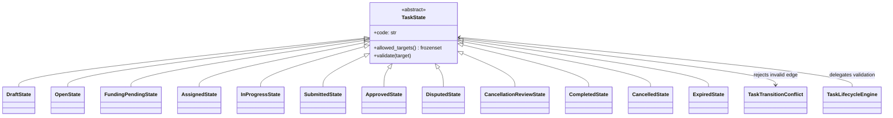

# T3-02 — Task Lifecycle / GoF State Pattern (FS-first)

**Primary authority:** `FS_Software(1).pdf`, pp. 6–11, particularly §5 RBAC, §6 M2–M5, BR-01 through BR-12 and **§7.2 transition table**. The ERD is a secondary model reference only; it must not override FS transitions.

## State structure (one concrete class per task state)



`tasks/lifecycle/states.py` defines the state classes. `tasks/lifecycle/engine.py` is the **sole production boundary for task status updates**: validates the edge and business event, enforces owner/selected executor permissions, requires finance or dispute references where appropriate, increments `version`, and appends `TaskStatusHistory`. Callers must first acquire a task `select_for_update()` lock inside an atomic transaction. The standalone `transition_task()` helper acquires that lock.

## Allowed edges (FS §7.2, exact)

| Source | Targets |
| --- | --- |
| `DRAFT` | `OPEN`, `CANCELLED` |
| `OPEN` | `FUNDING_PENDING`, `CANCELLED`, `EXPIRED` |
| `FUNDING_PENDING` | `ASSIGNED` **only on verified HOLD**, `OPEN` **on verified FAILED** |
| `ASSIGNED` | `IN_PROGRESS`, `CANCELLATION_REVIEW` |
| `IN_PROGRESS` | `SUBMITTED`, `CANCELLATION_REVIEW` |
| `SUBMITTED` | `APPROVED`, `DISPUTED` |
| `APPROVED` | `COMPLETED` **only after ledger RELEASED** |
| `DISPUTED` | `COMPLETED`, `CANCELLED` **only after recorded arbitration decision and financial result** |
| `CANCELLATION_REVIEW` | `CANCELLED` **after refund/settlement**, `DISPUTED` **with dispute case** |
| `COMPLETED` / `CANCELLED` / `EXPIRED` | terminal |

Invalid state edges, wrong event names, duplicate operations or missing financial evidence raise HTTP **409** with a structured `invalid_task_transition` error; unauthorized participants receive HTTP **403**. No external endpoint is added to arbitrarily set a task status.

## Sequence and ownership

```mermaid
sequenceDiagram
    actor E as Employer
    participant API as Existing task/bid APIs
    participant T as TaskLifecycleEngine
    participant F as Private Finance/Ledger Adapter
    participant B as Bid records
    E->>API: POST /api/tasks/ (create)
    API->>T: create DRAFT + history
    E->>API: POST /api/tasks/{id}/publish/
    API->>T: DRAFT -> OPEN
    E->>API: POST /api/offers/employer/bids/{id}/accept/
    API->>T: OPEN -> FUNDING_PENDING (selected bid ID)
    Note over B: Bids stay ACTIVE; no assignment yet
    F->>F: Verify escrow hold and idempotency
    F->>T: FUNDING_PENDING -> ASSIGNED, confirmed hold
    F->>B: ACCEPTED selected bid, REJECTED other ACTIVE bids
    Note over F,T: Atomic local DB transaction; no public finance callback yet
```

**Why acceptance endpoint semantics changed:** The prior ZIP immediately marked the bid `ACCEPTED`, rejected competitors and set task `ASSIGNED` without checking escrow. This violates FS §7.1, §7.2 and BR-04/05. The original URL and HTTP 200 remain, but the response now carries `task_status=FUNDING_PENDING`, `status=ACTIVE`. The frontend should display *awaiting funding*, not *assigned*.

`confirm_funded_bid(...)` and `release_failed_funding(...)` in `offers/employer_bid_decisions.py` are internal integration hooks only. No public endpoint allows clients to claim payment success. **Important:** `VerifiedFinancialEvent` is an internal adapter contract, not cryptographic proof; a production ledger adapter must authenticate the payment provider, verify task/bid/amount, operation idempotency and persistence *before* constructing and passing it. There is **no live escrow or dispute persistence/integration in the supplied ZIP**, so financial settlement and arbitration are intentionally **fail-closed** until those services exist. Do not claim real money moved or an executable end-to-end finance flow.

## Independent lifecycles

- Task statuses: `tasks/lifecycle/` and `tasks.models.Task.status`.
- Escrow-state policy (FS §7.3): `payments/lifecycle.py` — `INITIATED -> HELD -> RELEASED | REFUNDED | PARTIALLY_SETTLED`, or `INITIATED -> FAILED`. It does not reuse task statuses or write task state.
- Dispute-state policy: `reviews/dispute_lifecycle.py`. FS defines task `DISPUTED` outcomes and auditing but **does not specify the dispute case's own internal stages**. Those illustrative policy stages remain internal, not public API or a DB migration. Product approval is required before persisting/exposing them.
- A task cannot become `ASSIGNED`, `COMPLETED` or financially `CANCELLED` using task state alone. The internal ledger/case integration must produce recorded evidence and idempotency; this patch does not implement M5 or M6 in full.

## Existing API impact

- `POST /api/tasks/`: returns **DRAFT** with no `published_at`, restoring FS §6 M2; urgency, soft-delete and existing validation remain as in `backend(2).zip`.
- `POST /api/tasks/{id}/publish/`: now the centralized `DRAFT -> OPEN` transition; no administrator approval is needed; rejects expired proposal deadlines.
- `PATCH /api/tasks/{id}/`: unchanged URL and request/response; only DRAFT or OPEN without bids can be edited, as a safety condition inherited from the ZIP.
- `DELETE /api/tasks/{id}/`: still soft-deletes a DRAFT/OPEN task with no bids; uses the lifecycle engine for the `CANCELLED` history.
- `POST /api/tasks/{id}/cancel/`: FS §7.2 only permits direct cancellation of DRAFT/OPEN and review request in ASSIGNED/IN_PROGRESS. A task in FUNDING_PENDING/SUBMITTED/APPROVED/DISPUTED cannot skip to `CANCELLATION_REVIEW`.
- `POST /api/offers/employer/bids/{id}/accept/`: retains URL, auth and response type, but returns `FUNDING_PENDING` / bid `ACTIVE` before funding confirmation.
- `DELETE/PATCH /api/offers/bids/{id}/`: existing ZIP behavior stays; withdrawal lock acquisition is corrected to follow task-before-bid order.
- `python manage.py expire_open_tasks`: new **idempotent scheduled job** (must be scheduled in deployment) to expire overdue OPEN tasks and ACTIVE bids. It never touches money.

## Testing and acceptance trace

| Trello criterion | Implementation | Verification |
| --- | --- | --- |
| GoF State Pattern | 12 concrete `TaskState` classes | `FSMRuleTests.test_exact_fs_edges_have_corresponding_events` |
| Allowed transitions conform to FS §7 | Exact transition map and event guards | `FSMRuleTests` plus integration tests |
| Standardized invalid-transition domain errors | `TaskTransitionConflict` 409 JSON code, permission 403 | terminal / wrong-event / finance guard tests |
| Task, escrow and dispute state independent | Separate modules, no shared status field | `test_money_and_dispute_policies_are_not_task_states` |
| Class and transition documentation | This file's class/sequence diagrams, table | Reviewer inspection |

Existing ZIP test adjustments are limited to expected behavioral differences in `test_tasks_api.py` (create DRAFT) and `test_frontend_api_gaps.py` (funding pending). Existing unrelated tests are unchanged. New tests are added in `test_task_lifecycle_fs.py`.

### Run on configured PostgreSQL/PostGIS test database

```sh
python manage.py check
python manage.py makemigrations --check --dry-run
python manage.py test tests.test_task_lifecycle_fs tests.test_tasks_api tests.test_offers tests.test_frontend_api_gaps tests.test_task_discovery
python manage.py test tests
```

`git apply --check` and Python compilation are static validation; **Django DB integration tests must still pass in the user's configured environment before checking off deployment acceptance**. Concurrency/payment retry tests require real PostgreSQL + trusted finance adapter and must be completed alongside M5.
