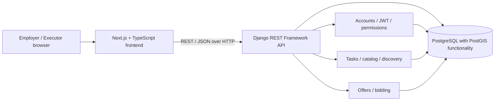
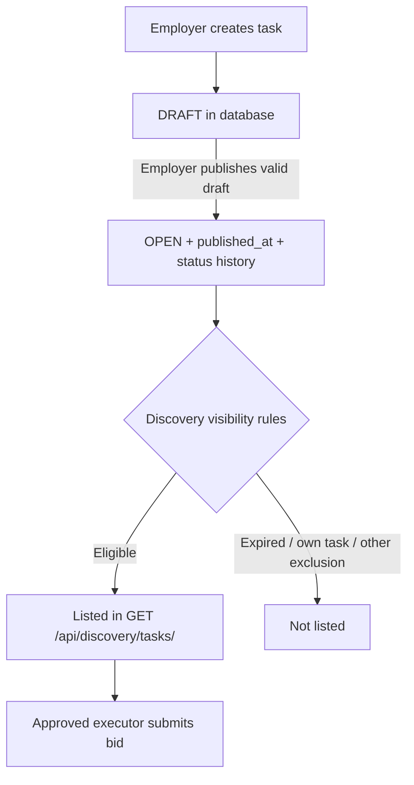

# VAKA — System Architecture

## Scope and evidence

This describes the implementation observed in the supplied November 2026 backend/frontend snapshots and OpenAPI export. The ERD and `Technology-Stack.md` in the supplied `architecture.zip` are **design references**; they contain future capabilities that have not all been implemented.

## System overview

The frontend uses the Next.js App Router (`frontend/src/app/`) and calls the backend with `NEXT_PUBLIC_API_BASE_URL`. The backend provides REST endpoints, Django models and migrations, JWT-based authentication, and Swagger/OpenAPI documentation through drf-spectacular.

## Backend applications

| App | Present implementation / observed scope |
| --- | --- |
| `accounts` | User, roles, OTP/password authentication, executor profile, worker skills, preferences, service area, availability, verification |
| `tasks` | Task and category models, skill catalog, task creation and publication, location data, discovery endpoints |
| `offers` | Bid submission, listing/updating, employer-side bid reads, bid status history |
| `execution` | Application scaffold in the inspected backend; no operational models present in that snapshot |
| `payments` | Application scaffold in the inspected backend; payment and ledger models are not yet implemented there |
| `reviews` | Application scaffold in the inspected backend; rating/review models are not yet implemented there |
| `discovery`, `notifications` | Application scaffolds; actual task-discovery API is implemented in `tasks/views.py` in the inspected snapshot |

The later OpenAPI file also includes worker-neighborhood and worker-statistics endpoints. This may be ahead of the earlier backend ZIP, so confirm the target branch before release.

## Authentication and authorization

- Login is available via password or OTP, with JWT access/refresh endpoints.
- Protected APIs expect `Authorization: Bearer <access_token>`; missing/invalid credentials produce `401`.
- Role and verification checks may produce `403` after authentication.
- The observed backend REST authentication configuration includes JWT and session authentication; Basic authentication is not enabled in the inspected settings.
- `EMPLOYER` authorization governs task creation/publication. An approved, active executor is required for executor-specific discovery/bidding behavior.
- Worker identity verification is distinct from basic phone verification; worker verification status does not imply employer identity-verification support.

## Task lifecycle and data flow

`POST /api/tasks/` and the publish operation save records transactionally; the publish service acquires a row lock and writes a status-history record. Publishing a task does **not** cause Django to call the discovery GET endpoint. The frontend or API client calls discovery separately.

Current publish validation checks required text, active category, duration (1–300 minutes), non-negative wages, a valid ordered execution window, and a proposal deadline. The inspected publication service did **not** require those dates to still be in the future at publication time. Discovery separately excludes expired tasks. That edge case should be tracked as a validation improvement rather than documented as already solved.

## Geospatial behavior

- Task locations can have multiple ordered stops (`stop_order`).
- The backend stores exact and approximate coordinates using PostgreSQL/PostGIS geography functions.
- Discovery supports city/region and radius filters; `latitude`, `longitude`, and `radius_meters` must be supplied together for geospatial filtering.
- A worker's service-area settings store city, region, center coordinates and radius in kilometres.
- The later coverage feature stores selected neighborhood **names** and a `covers_entire_city` flag; it does not infer neighborhood polygons or automatically apply those preferences as task-matching constraints.

## Proposed future design (not shipped in the reviewed backend snapshot)

The supplied ERD includes more extensive assignment, cancellation, escrow, ledger, reviews, dispute-adjacent processes, recommendations, and events. Treat these as architecture proposals until matching Django models, migrations, services and tested APIs exist. Avoid presenting the design ERD as an accurate dump of the live database.

## Important source locations

- `backend/config/settings.py`, `backend/config/urls.py`
- `backend/accounts/models.py`, `backend/accounts/profile_urls.py`
- `backend/tasks/models.py`, `backend/tasks/services.py`, `backend/tasks/views.py`
- `backend/offers/models.py`, `backend/offers/views.py`
- `frontend/src/app/`, `frontend/src/lib/`
- Supplied archive: `architecture/Technology-Stack.md` and `architecture/erd/`

## Update policy

Update this document whenever component ownership, auth behavior, task state transitions, or service boundaries change. Verify changes against source code and generated OpenAPI, then review the relevant ERD as a separate design artifact.
