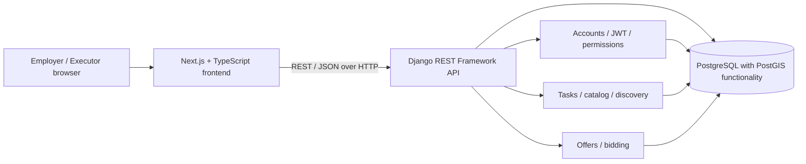
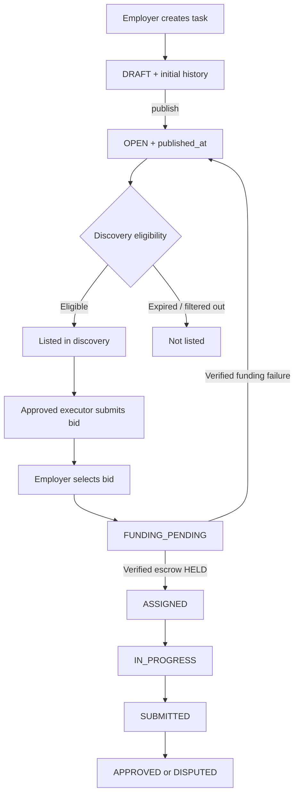
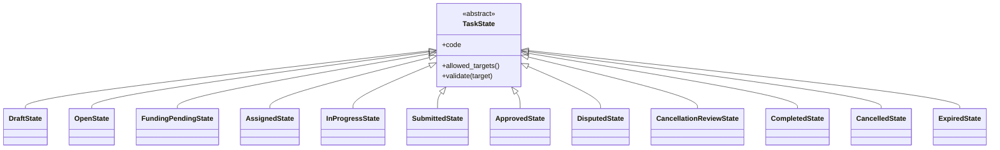

# VAKA — System Architecture

## Scope and evidence

This document combines the observed November 2026 VAKA backend/frontend snapshots with the T3-02 FS-aligned Task Lifecycle State Pattern implementation. For lifecycle rules, the authoritative source is **FS Software, Section 7.2 (Task State Machine, pages 10–11)**, supplemented by Sections 5, 6.5, 7.3 and 7.4. The ERD is a **secondary design reference**, not the source of permitted transitions.

Implementation references below describe the T3-02 lifecycle patch applied to the backend ZIP; the finance/escrow ledger and dispute case workflows are still **not fully operational**. Validate the final branch and test report before treating this as a release record.

## System overview

The frontend uses the Next.js App Router (`frontend/src/app/`) and calls the backend with `NEXT_PUBLIC_API_BASE_URL`. The backend provides REST endpoints, Django models and migrations, JWT-based authentication, and Swagger/OpenAPI documentation through drf-spectacular.

## Backend applications

| App | Present implementation / observed scope |
| --- | --- |
| `accounts` | User, roles, OTP/password authentication, executor profile, worker skills, preferences, service area, availability, verification |
| `tasks` | Task/category data, CRUD and discovery, plus FS-based GoF State Pattern in `tasks/lifecycle/` (`states.py`, `engine.py`, `errors.py`) |
| `offers` | Bid submission/update/withdrawal, employer decisions, and bid history; selection moves Task to `FUNDING_PENDING` before verified funding |
| `execution` | Application scaffold; complete assignment and execution persistence is not part of the reviewed T3-02 patch |
| `payments` | Independent escrow transition policy in `payments/lifecycle.py`; no integrated persisted escrow wallet/ledger confirmed |
| `reviews` | Independent, provisional dispute-case transition policy in `reviews/dispute_lifecycle.py`; no integrated persisted dispute-case workflow confirmed |
| `discovery`, `notifications` | Application scaffolds; actual task-discovery API is implemented in `tasks/views.py` in the inspected snapshot |

The later OpenAPI file also includes worker-neighborhood and worker-statistics endpoints. This may be ahead of the earlier backend ZIP, so confirm the target branch before release.

## Authentication and authorization

- Login is available via password or OTP, with JWT access/refresh endpoints.
- Protected APIs expect `Authorization: Bearer <access_token>`; missing/invalid credentials produce `401`.
- Role and verification checks may produce `403` after authentication.
- The observed backend REST authentication configuration includes JWT and session authentication; Basic authentication is not enabled in the inspected settings.
- `EMPLOYER` authorization governs task creation/publication. An approved, active executor is required for executor-specific discovery/bidding behavior.
- Worker identity verification is distinct from basic phone verification; worker verification status does not imply employer identity-verification support.

## Task lifecycle and data flow

Task creation records a `DRAFT` and its initial history entry, and publishing follows the server-controlled `DRAFT -> OPEN` transition. Publication does **not** require administrator approval. The task lifecycle engine uses a locked database transaction and records each transition in `TaskStatusHistory`. Discovery is a separate GET request; publishing a task does not invoke discovery automatically.

Publication validation covers required text, active category, estimated duration of 1–300 minutes, non-negative wage values, execution-window ordering and proposal deadline. Discovery additionally filters out non-`OPEN` or expired tasks. Client applications must not set `Task.status` directly.

## T3-02 — Task Lifecycle State Design Pattern (FS Section 7.2)

**Source of truth:** FS Software, Section 7.2, pages 10–11. The GoF **State Pattern** isolates allowed outgoing edges in a concrete state class for each of the 12 `TaskStatus` values. The engine validates the state edge **and** the business event, actor, financial/dispute evidence and timing conditions.

### Diagrams (tracked under `docs/src/`)

[Open task lifecycle SVG](src/mermaid-diagram.svg)

[Open Tasks, Bids & Cancellation ERD](src/erd/03%20-%20Tasks%2C%20Bids%20%26%20Cancellation.svg)

The SVG above is the visual reference. The authoritative transition list below is derived from FS Section 7.2. Keep the SVG synchronized with that list.

### Allowed task transitions

| Source state | Allowed target states |
| --- | --- |
| `DRAFT` | `OPEN`, `CANCELLED` |
| `OPEN` | `FUNDING_PENDING`, `CANCELLED`, `EXPIRED` |
| `FUNDING_PENDING` | `ASSIGNED`, `OPEN` |
| `ASSIGNED` | `IN_PROGRESS`, `CANCELLATION_REVIEW` |
| `IN_PROGRESS` | `SUBMITTED`, `CANCELLATION_REVIEW` |
| `SUBMITTED` | `APPROVED`, `DISPUTED` |
| `APPROVED` | `COMPLETED` (only after verified settlement) |
| `DISPUTED` | `COMPLETED`, `CANCELLED` (only after a recorded financial ruling) |
| `CANCELLATION_REVIEW` | `CANCELLED`, `DISPUTED` |
| `COMPLETED`, `CANCELLED`, `EXPIRED` | Terminal; no outgoing transitions |

This is **18 directed state-to-state edges** across **12 Task states**. New-task initialization is not counted as an edge. The engine rejects all other source/target combinations (for example, `OPEN -> ASSIGNED`, `ASSIGNED -> COMPLETED`, or reopening `CANCELLED`).

### Class and service responsibilities

- `backend/tasks/lifecycle/states.py`: abstract `TaskState`, 12 concrete state classes and the allowed-state map (`state_for`).
- `backend/tasks/lifecycle/engine.py`: checks source/target and event guards, ownership/role and financial evidence; persists `Task.status`, increments `Task.version`, and appends `TaskStatusHistory` in a transaction.
- `backend/tasks/lifecycle/errors.py`: standardized `TaskTransitionConflict` (`409 Conflict`) for invalid domain transitions. Authorization failures are separate (`403`).
- `backend/tasks/services.py`, `backend/tasks/task_management.py`, and `backend/offers/employer_bid_decisions.py`: should call the engine rather than modifying `Task.status` directly. Lock the task before related bids to avoid inconsistent concurrent updates.

### Financial and dispute boundaries (FS Sections 7.2–7.4)

Task state, escrow state and dispute-case state are **independent domains**:

- **Task:** `tasks/lifecycle/` owns the 12 states in the table above.
- **Escrow policy:** `payments/lifecycle.py` defines `INITIATED -> HELD` or `FAILED`, and `HELD -> RELEASED`, `REFUNDED` or `PARTIALLY_SETTLED`. This is a policy-only layer, **not** a persisted escrow/ledger implementation.
- **Dispute-case policy:** `reviews/dispute_lifecycle.py` defines provisional internal stages (`OPEN`, `UNDER_REVIEW`, `DECIDED`, `CLOSED`). FS requires separation but does not prescribe these detailed dispute-case names; they are not a public API contract.

The flow `OPEN -> FUNDING_PENDING -> ASSIGNED` must not skip verified escrow funding. Likewise, `APPROVED -> COMPLETED` requires verified settlement; dispute outcomes require a recorded decision and financial evidence. A public API caller must not assert a financial confirmation. A task-state update does **not** itself release, reserve or refund money.

**Implementation limit:** The T3-02 patch establishes policy boundaries and guarded integration points, not working financial settlement or dispute-case persistence. Wiring up M5/M6 requires separate finance and arbitration services with idempotency and audit trails.

### Tests and traceability

- `backend/tests/test_task_lifecycle_fs.py` checks the 12-state / 18-edge graph and representative event/authorization/finance guards. The transition-matrix test covers 144 source/target combinations (18 allowed, 126 rejected).
- Existing task/offer/discovery regression suites should remain part of CI after the refactor.
- A prior local run reported 429 tests and one financial-guard test error, subsequently addressed by a test-only patch; confirm a successful full-suite rerun on the target branch before recording a green release.
- For schema relationships and ERD evidence see [DATABASE.md](DATABASE.md).

## Geospatial behavior

- Task locations can have multiple ordered stops (`stop_order`).
- The backend stores exact and approximate coordinates using PostgreSQL/PostGIS geography functions.
- Discovery supports city/region and radius filters; `latitude`, `longitude`, and `radius_meters` must be supplied together for geospatial filtering.
- A worker's service-area settings store city, region, center coordinates and radius in kilometres.
- The later coverage feature stores selected neighborhood **names** and a `covers_entire_city` flag; it does not infer neighborhood polygons or automatically apply those preferences as task-matching constraints.

## Proposed future design (not shipped in the reviewed backend snapshot)

The supplied ERD includes assignment, escrow/ledger, dispute, reviews, recommendations and events. The T3-02 Task State Pattern and policy-only escrow/dispute modules do **not** imply that all these entities or integrations exist in the database. Treat unimplemented ERD entities as proposed until matching Django models, migrations, services and tests are available.

## Important source locations

- `backend/config/settings.py`, `backend/config/urls.py`
- `backend/accounts/models.py`, `backend/accounts/profile_urls.py`
- `backend/tasks/models.py`, `backend/tasks/services.py`, `backend/tasks/views.py`
- `backend/tasks/lifecycle/states.py`, `engine.py`, `errors.py`
- `backend/offers/models.py`, `backend/offers/views.py`, `backend/offers/employer_bid_decisions.py`
- `backend/payments/lifecycle.py`, `backend/reviews/dispute_lifecycle.py` (policy only)
- `backend/tests/test_task_lifecycle_fs.py`
- `frontend/src/app/`, `frontend/src/lib/`
- Diagrams in this repository: `docs/src/mermaid-diagram.svg` and `docs/src/erd/`
- Supplied archive reference: `architecture/Technology-Stack.md` and `architecture/erd/`

## Update policy

Update this document whenever component ownership, auth behavior, task state transitions, or service boundaries change. Verify changes against source code and generated OpenAPI, then review the relevant ERD as a separate design artifact.
