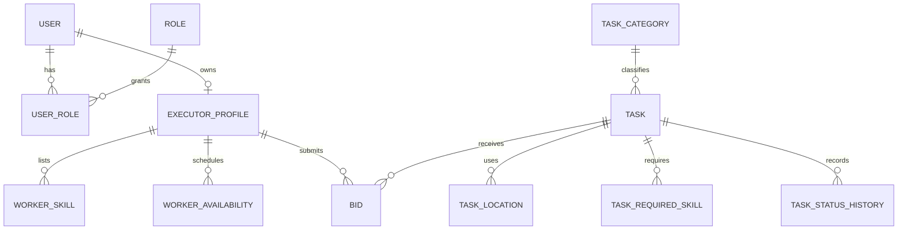

# VAKA — Database and ERD

## Source and scope

The implemented backend uses **PostgreSQL**, Django models/migrations and PostGIS geography operations for task locations. The supplied `architecture/erd/` diagrams are **target architecture diagrams**, not necessarily the current physical schema. Do not apply a diagram directly as a migration without reconciling it with Django models and existing constraints.

## Implemented domain models in the inspected backend snapshot

| App | Models found |
| --- | --- |
| `accounts` | `User`, `Role`, `UserRole`, `ExecutorProfile`, `WorkerSkill`, `WorkerAvailability`, `WorkerVerificationDocument`, `OTPChallenge` |
| `tasks` | `TaskCategory`, `Skill`, `Task`, `TaskAttachment`, `TaskStatusHistory`, `TaskRequiredSkill`, `TaskLocation`, `PriceEstimate` |
| `offers` | `Bid`, `BidStatusHistory` |
| `execution`, `payments`, `reviews`, `discovery`, `notifications` | No implemented models in the inspected backend ZIP |

The newer worker-coverage change adds `WorkerServiceNeighborhood` and `ExecutorProfile.covers_entire_city` (migration `accounts/0012_worker_coverage.py`). Those changes are present in the supplied patch and later OpenAPI schema, but were **not** present in the earlier backend ZIP; confirm the active branch before generating an up-to-date ERD.

## Key relationships



This diagram is deliberately **simplified**; consult the model definitions for column names, constraints and delete policies.

### Users and roles

- `User` is the account identity; roles are modeled through `Role` and `UserRole`.
- A user may have an optional `ExecutorProfile` containing worker verification/profile information.
- Phone verification and worker identity verification are separate states.
- The worker-verification review process stores status and timestamps; private documents require controlled access.

### Tasks and locations

- A `Task` belongs to an employer and category and has a state such as `DRAFT` or `OPEN`.
- A task can require multiple catalog skills via `TaskRequiredSkill`.
- A task can contain multiple ordered locations (`TaskLocation.stop_order`).
- Exact and approximate geographic points are represented using geography/PostGIS operations; avoid exposing exact/private coordinates in public discovery responses.
- Task status transitions are recorded in `TaskStatusHistory`.

### Bids

- `Bid` references one task and one executor profile.
- A database uniqueness constraint prevents duplicate bids from the same executor for the same task.
- A conditional uniqueness constraint prevents more than one `ACCEPTED` bid per task.
- `BidStatusHistory` captures bid state transitions.

### Worker coverage additions

The later feature contains:

- `ExecutorProfile.covers_entire_city` (boolean, default false).
- `WorkerServiceNeighborhood`: UUID key, executor-profile FK, neighborhood name and creation timestamp.
- Case-insensitive uniqueness of neighborhood name per executor profile.

Neighborhood names **do not** currently represent geospatial polygons or verified districts, so they must not be assumed suitable for point-in-polygon matching.

## PostGIS and migrations

Task location creation uses geography functions such as `ST_SetSRID` and `ST_MakePoint`, and radius queries use geography distance operations. PostgreSQL must have the appropriate PostGIS extension available. The inspected Django database engine is `django.db.backends.postgresql` (the code uses SQL functions directly).

From `backend/`:

```powershell
python manage.py showmigrations
python manage.py makemigrations --check --dry-run
python manage.py migrate
```

Run migrations against a local/staging database first. **Do not run** destructive or ad-hoc schema changes against production. `makemigrations --check --dry-run` should show no model changes requiring a new migration on a clean branch.

## Physical schema versus proposed ERD

The supplied ERD also describes assignments, cancellation policies, escrow/ledger, reviews, recommendations and operational events. Those sections represent **planned architecture** unless current application models/migrations confirm them. A top-level `reviews` app directory alone does not mean review tables exist.

Source diagrams provided in `architecture.zip`:

- `architecture/erd/00 - Full ERD.svg`
- `architecture/erd/01 - Identity & Verification.svg`
- `architecture/erd/02 - Matching & Recommendations.svg`
- `architecture/erd/03 - Tasks, Bids & Cancellation.svg`
- `architecture/erd/04 - Finance & Ledger.svg`
- `architecture/erd/05 - Reviews & Operations.svg`
- `architecture/erd/README.md` explains design decisions and assumptions.

Preserve the original diagrams as design records; when copying into the repository, place them under `docs/architecture/erd/`, keep filenames and links consistent, and label any unimplemented entities as planned.

## Maintenance checklist

- Update Django model, migration, validation, tests, and relevant ERD together.
- Record any new indexes, uniqueness, checks and nullability changes.
- Never include production DB credentials or real user records in documentation.
- Review data sensitivity when exposing addresses, coordinates or verification documents.
