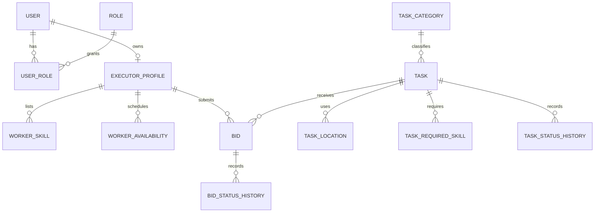

# VAKA — Database and ERD

## Source and scope

The backend uses **PostgreSQL**, Django models/migrations and PostGIS geography operations for task locations. This document describes the actual task/bid tables seen in the provided backend ZIP and the T3-02 FS-aligned State Pattern. The diagrams under `docs/src/erd/` are **target ERD references**, not automatically the deployed physical schema.

For task lifecycle rules, **FS Software Section 7.2 (pages 10–11) takes precedence over the ERD**. Never apply an ERD directly as a migration; reconcile it with Django models, actual migrations and tests.

## Implemented domain models in the inspected backend snapshot

| App | Models found |
| --- | --- |
| `accounts` | `User`, `Role`, `UserRole`, `ExecutorProfile`, `WorkerSkill`, `WorkerAvailability`, `WorkerVerificationDocument`, `OTPChallenge` |
| `tasks` | `TaskCategory`, `Skill`, `Task`, `TaskAttachment`, `TaskStatusHistory`, `TaskRequiredSkill`, `TaskLocation`, `PriceEstimate` |
| `offers` | `Bid`, `BidStatusHistory` |
| `execution`, `payments`, `reviews`, `discovery`, `notifications` | No operational models in the inspected backend ZIP; `payments/lifecycle.py` and `reviews/dispute_lifecycle.py` contain separate **policy code**, not persisted finance/dispute entities |

The newer worker-coverage change adds `WorkerServiceNeighborhood` and `ExecutorProfile.covers_entire_city` (migration `accounts/0012_worker_coverage.py`). Those changes are present in the supplied patch and later OpenAPI schema, but were **not** present in the earlier backend ZIP; confirm the active branch before generating an up-to-date ERD.

## Key relationships



This diagram is deliberately **simplified**; consult the model definitions for column names, constraints and delete policies.

### Users and roles

- `User` is the account identity; roles are modeled through `Role` and `UserRole`.
- A user may have an optional `ExecutorProfile` containing worker verification/profile information.
- Phone verification and worker identity verification are separate states.
- The worker-verification review process stores status and timestamps; private documents require controlled access.

### Tasks and locations

- A `Task` belongs to an employer and category. `Task.status` stores the **current task lifecycle status** (`TaskStatus`), not escrow or dispute status.
- In the supplied backend ZIP, `Task.urgency` is a separate business field, `Task.deleted_at` enables soft deletion, `Task.published_at` records publication and `Task.version` increments with lifecycle transitions. None of `urgency` or `deleted_at` is an extra Task State Pattern status.
- A task can require multiple catalog skills via `TaskRequiredSkill` and multiple ordered locations via `TaskLocation.stop_order`.
- Exact and approximate geographic points use PostGIS operations; exact/private coordinates must not appear in public discovery responses.
- `TaskStatusHistory` stores `from_status`, `to_status`, `changed_by_user`, `reason`, `created_at` and optional `metadata` (for example lifecycle event and references). An initial creation history row has `from_status = NULL` and `to_status = DRAFT`.
- T3-02 enforces valid transitions in application services using a central transaction-bound engine; the database `CHECK` on valid status values does **not** by itself enforce legal source/target edges.

### Bids

- `Bid` references one task and one executor profile.
- A database uniqueness constraint prevents duplicate bids from the same executor for the same task.
- A conditional uniqueness constraint prevents more than one `ACCEPTED` bid per task.
- `BidStatusHistory` captures bid state transitions.
- FS Section 7.2 requires `OPEN -> FUNDING_PENDING` when an employer selects a bid; the task must reach `ASSIGNED` only after verified funding. The selected bid is not necessarily `ACCEPTED` during pending funding. Funding/escrow status is **not** a column encoded in `Task.status`.

## T3-02 — Task State Pattern and persistence boundaries

### Reference diagrams

**Tasks, Bids & Cancellation ERD (target design):**


[Open full ERD](src/erd/00%20-%20Full%20ERD.svg) · [Open Finance & Ledger ERD](src/erd/04%20-%20Finance%20%26%20Ledger.svg) · [Open Reviews & Operations ERD](src/erd/05%20-%20Reviews%20%26%20Operations.svg)

**FS-based Task State Machine:**


[Open State Machine SVG](src/mermaid-diagram.svg) · [Read lifecycle architecture](ARCHITECTURE.md)

Images show the **design**; actual physical tables and columns must be verified against `backend/tasks/models.py`, `backend/offers/models.py` and applied migrations.

### Lifecycle-related persisted data

| Entity / field | Responsibility | Storage status |
| --- | --- | --- |
| `Task.status` | One current task state from the 12 FS states | Persisted in `tasks` |
| `Task.version` | Optimistic/versioning support; increment on a lifecycle transition | Persisted in `tasks` |
| `Task.published_at` | Timestamp for `DRAFT -> OPEN` | Persisted in `tasks` |
| `Task.deleted_at` | Soft-delete marker; **not** an FSM status | Persisted in the supplied ZIP |
| `Task.urgency` | Task urgency; **not** an FSM status | Persisted in the supplied ZIP |
| `TaskStatusHistory` | Audit record of source/target status, actor, reason, timestamp and metadata | Persisted in `task_status_history` |
| `Bid.status` | Independent bid state: `ACTIVE`, `ACCEPTED`, `REJECTED`, `WITHDRAWN`, `EXPIRED` | Persisted in `bids` |
| `BidStatusHistory` | Separate bid transition history | Persisted in `bid_status_history` |
| Escrow balance, hold and ledger entries | Required for trusted funding/refund/settlement confirmation | **Not yet persisted/integrated** in the inspected patch |
| Dispute case and ruling | Required for audited dispute outcomes | **Not yet persisted/integrated** in the inspected patch |

### Consistency and domain rules

1. FS Section 7.2 defines **12 task states and 18 legal outgoing edges**. `TaskStatus` stores only those task states; invalid transitions are rejected in `tasks/lifecycle/states.py` and `engine.py`, not through client-side checks.
2. `tasks/lifecycle/engine.py` updates Task status, version and task history in an atomic transaction while holding a task row lock. A caller should lock the task before locking its bids; direct `task.status = ...` writes outside the engine would bypass the intended domain protections.
3. `FUNDING_PENDING -> ASSIGNED` needs a trusted `HELD` funding result. `APPROVED -> COMPLETED` needs verified release/settlement. Dispute resolution similarly requires a decision reference and financial evidence. These prerequisites cannot be inferred from `Task.status` alone.
4. The independent **escrow policy** in `payments/lifecycle.py` and **dispute-case policy** in `reviews/dispute_lifecycle.py` are currently code-level transition policies, **not independent database state machines with complete persistence**. The exact internal dispute-case stages are provisional; FS does not define their detailed names.
5. `COMPLETED`, `CANCELLED` and `EXPIRED` are terminal states. Deleted tasks remain auditable through `TaskStatusHistory`; do not physically cascade-delete related bids or history.
6. Preserve Task ownership/role checks, bid uniqueness constraints, separation of financial and wage amounts, and the public discovery filter that excludes non-open/expired tasks.

### Files to check when the schema evolves

- Models and migrations: `backend/tasks/models.py`, `backend/tasks/migrations/`, `backend/offers/models.py`, `backend/offers/migrations/`.
- State Pattern: `backend/tasks/lifecycle/states.py`, `backend/tasks/lifecycle/engine.py`, `backend/tasks/lifecycle/errors.py`.
- Application policies: `backend/payments/lifecycle.py`, `backend/reviews/dispute_lifecycle.py`.
- Regression tests: `backend/tests/test_task_lifecycle_fs.py`, plus the existing task, offer and discovery suites.

## Worker coverage additions

The later feature contains:

- `ExecutorProfile.covers_entire_city` (boolean, default false).
- `WorkerServiceNeighborhood`: UUID key, executor-profile FK, neighborhood name and creation timestamp.
- Case-insensitive uniqueness of neighborhood name per executor profile.

Neighborhood names **do not** currently represent geospatial polygons or verified districts, so they must not be assumed suitable for point-in-polygon matching.

## PostGIS and migrations

Task location creation uses geography functions such as `ST_SetSRID` and `ST_MakePoint`, and radius queries use geography distance operations. PostgreSQL must have the appropriate PostGIS extension available. The inspected Django database engine is `django.db.backends.postgresql` (the code uses SQL functions directly).

From `backend/`:

```powershell
python manage.py showmigrations
python manage.py makemigrations --check --dry-run
python manage.py migrate
```

Run migrations against a local/staging database first. **Do not run** destructive or ad-hoc schema changes against production. `makemigrations --check --dry-run` should show no model changes requiring a new migration on a clean branch.

## Physical schema versus proposed ERD

The supplied ERD also describes assignments, cancellation policies, escrow/ledger, reviews, recommendations and operational events. Those sections represent **planned architecture** unless current application models/migrations confirm them. A top-level `reviews` app directory alone does not mean review tables exist.

The original ERD diagrams came from `architecture.zip`; the user-maintained copies are organized under `docs/src/erd/`:

- [00 — Full ERD](src/erd/00%20-%20Full%20ERD.svg)
- [01 — Identity & Verification](src/erd/01%20-%20Identity%20%26%20Verification.svg)
- [02 — Matching & Recommendations](src/erd/02%20-%20Matching%20%26%20Recommendations.svg)
- [03 — Tasks, Bids & Cancellation](src/erd/03%20-%20Tasks%2C%20Bids%20%26%20Cancellation.svg)
- [04 — Finance & Ledger](src/erd/04%20-%20Finance%20%26%20Ledger.svg)
- [05 — Reviews & Operations](src/erd/05%20-%20Reviews%20%26%20Operations.svg)

Preserve the images as design records; keep filenames, relative links and implemented-vs-planned labels in sync. Full financial and dispute entities in these diagrams are not evidence of deployed database tables.

## Maintenance checklist

- Update Django model, migration, validation, tests, and relevant ERD together.
- Record any new indexes, uniqueness, checks and nullability changes.
- Never include production DB credentials or real user records in documentation.
- Review data sensitivity when exposing addresses, coordinates or verification documents.
